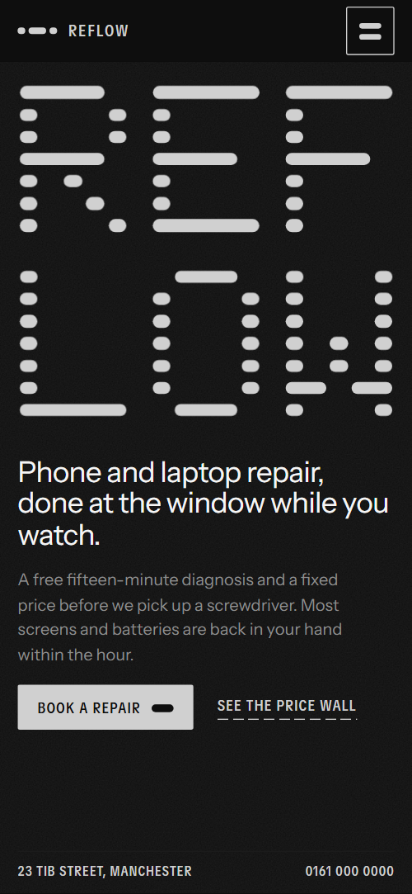
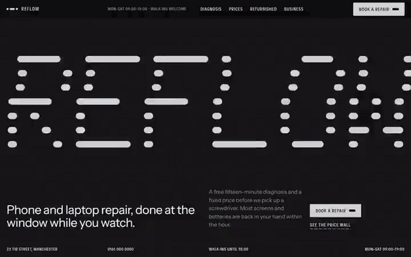

# Free HTML repair shop website template with GSAP scroll animations — Reflow

**Website for a phone and laptop repair shop with walk-in repairs, prices and refurbished devices: a free HTML template in one file, with GSAP scroll animations, no build step, MIT license. Made by [8B](https://8b.com/), the AI website builder.**

[](LICENSE)  

**[Live demo](https://8bsite.github.io/repair-shop-website-template/)** · **[Use this template](https://github.com/new?template_name=repair-shop-website-template&template_owner=8bsite)** · **[Download ZIP](https://github.com/8bsite/repair-shop-website-template/archive/refs/heads/main.zip)**

<a href="https://8bsite.github.io/repair-shop-website-template/"></a> <a href="https://8bsite.github.io/repair-shop-website-template/"></a>

<p align="center"><a href="https://8bsite.github.io/repair-shop-website-template/"></a><br><sub>Scroll animation</sub></p>

A one-page site for a phone and laptop repair shop with a free diagnosis, a price list, refurbished stock, business pickups and repairs by post. Near-black and white with one electric blue; the wordmark is built from rounded dashes that stretch and flood the screen on the first scroll, and a blue selection scans the checklist, crosses the pickup schedule and reads along the reviews.

Good for: phone, laptop or computer repair shop; electronics, console or watch repair; refurbished device shop; any walk-in service with a price list and a booking form.

## Use it with an AI coding agent

Download the files into your project (in Windows PowerShell type `curl.exe`):

```bash
curl -LO https://raw.githubusercontent.com/8bsite/repair-shop-website-template/main/index.html
curl -LO https://raw.githubusercontent.com/8bsite/repair-shop-website-template/main/AGENTS.md
curl -LO https://raw.githubusercontent.com/8bsite/repair-shop-website-template/main/LICENSE
curl -LO https://raw.githubusercontent.com/8bsite/repair-shop-website-template/main/CREDITS.md
```

Then give your agent this prompt:

```text
Read AGENTS.md, then edit index.html. Use this template as the base for a site for <your repair business: what you fix, where you are, opening hours, prices, how to book>. Keep the layout, the motion and the single-file format; replace the brand name and the dash wordmark, copy, photos, prices, times, stock, links and contacts, and recolour it through the CSS variables if needed.
```

Give the agent the downloaded file, not a link: from a link it would rebuild a different page. No agent? Click **[Use this template](https://github.com/new?template_name=repair-shop-website-template&template_owner=8bsite)**, edit `index.html` and turn on **Settings → Pages**.

## What's on the page

- **Navigation** — top bar: dash mark and name, opening hours, section links, Book a repair button; phone menu overlay
- **Reflow: Phone and laptop repair, done at the window while you watch.** — two screens: a dash-built wordmark with headline and contact bar, then a staircase statement with three photos (demo: REFLOW, "Most broken things are fixable.")
- **Fifteen minutes, free, out loud.** — service explainer: staircase heading, paragraph and a twelve-row checklist with results and a quote (demo: the free diagnosis)
- **Price wall** — price list table grouped by device, each row with models, a time bar and a price (demo: Price wall)
- **Fixed at the window.** — how-we-work block: staircase heading over a wide photo cut into four strips, three columns of text (demo: "Fixed at the window.")
- **Three grades of part. You choose, and the receipt names the one we fitted.** — comparison table of three options with four rows and an example price (demo: Original, Certified, Value parts)
- **Second life** — horizontal shelf of numbered products with photo, specs, price and a Reserve link (demo: five refurbished devices)
- **For offices and schools: we collect on a weekly route, leave a loan device for every one we take and invoice once a month.** — business offer with a weekly schedule drawn as bars on an hour grid (demo: office and school pickups, Monday to Friday)
- **Post it.** — how it works: four steps under one dashed line and a button (demo: repair by post)
- **Reviews** — three customer quotes in large type, each with name and device
- **Before you ask.** — questions and answers (native &lt;details&gt;)
- **Come to the bench.** — contact and booking: staircase heading, address, hours, phone and email, a photo and a booking form (placeholders)
- **Footer** — dashed rule, one-line description, address, contact and page links, copyright and the Design: 8B credit

## Design

Palette:          
Fonts: Instrument Sans, TikTok Sans (Google Fonts). Change both through the CSS variables in the `:root` block at the top of `<head>`.

- The REFLOW wordmark on the first screen is not a font: each letter is a 5-column grid of rounded dashes in the markup (.op-wm__letter, .op-wm__row, <i style="grid-column:…">). For another name, redraw the letters in the same way, or replace the block with text.
- The time bars on the price wall (style="--m:<minutes>") and the pickup windows (style="--a:<hour>;--b:<hour>") are sized from those numbers: update them together with the visible times.

## Before you publish

- Replace everything marked `data-8b-placeholder` (social preview image, favicon, phone, email, form) and the invented demo facts: prices, dates, address. [AGENTS.md](AGENTS.md) lists them.
- The form sends nothing yet: connect it to Formspree or Netlify Forms, or remove it.

## Tech

GSAP 3.13.0, ScrollTrigger, SplitText, Lenis 1.3.27 from jsDelivr, 108 KB, no build step. Chrome and Edge 108+, Safari 16+, Firefox 110+ (it uses container query units, cascade layers, small/dynamic viewport units). With "reduce motion" on, the page is complete and still.

## License

MIT, see [LICENSE](LICENSE); the "Design: 8B" footer link is welcome, not required. Photos, fonts and libraries keep their own licences: [CREDITS.md](CREDITS.md). More free templates: [github.com/8bsite](https://github.com/8bsite).
